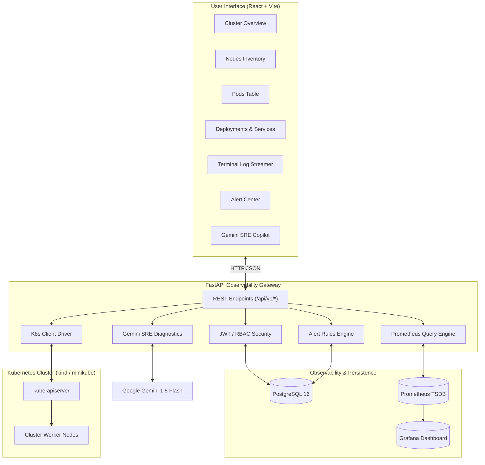

# K8sPulse - System Architecture

## Architecture Diagram

## Core Subsystems

### 1. Frontend Client
- **Framework**: React 18, TypeScript, Vite, Tailwind CSS.
- **Charts**: Recharts Area & Line charts for PromQL telemetry.
- **Polling Strategy**: 10-second background polling for cluster resources, 3-second live streaming for pod logs.

### 2. FastAPI Observability Backend
- **Framework**: FastAPI (ASGI), Pydantic v2 Settings & Schemas.
- **Resilience**: Operates in live Kubernetes cluster mode or automated fallback diagnostic mode so development never halts.
- **Security**: OAuth2 Bearer JWT tokens, bcrypt password hashing, non-root containers.

### 3. Metric Telemetry (Prometheus & PromQL)
- Ingests CPU utilization, memory working sets, network RX/TX rates, and container restarts.

### 4. Gemini AI Copilot
- Translates cluster warnings, resource starvation, and CrashLoopBackOff container logs into human-readable diagnoses with actionable `kubectl` remediation commands.
